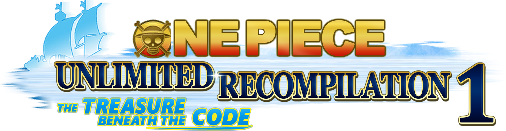

# One Piece: Unlimited Recompilation Episode 1

<p align="center">
  
  
  
  <a href="LICENSE"></a>
</p>

A native PC build of **One Piece Unlimited Cruise Episode 1** (Wii, PAL `ROUPAF`), made with static recompilation:
the game's `main.dol` is translated to C++ ahead of time and compiled into a normal Windows executable.

There is no emulator in the loop, no interpreter, no JIT and no PowerPC code at run time.

> [!IMPORTANT]
> There is no game code, no assets and no game data anywhere in this repository.
> You need your own dump of the PAL disc. The translation runs on your machine against your dump, and nothing in this
> project uploads anything.

---

## What it does

**Boots the real game natively.** All 18,849 functions of `main.dol` are translated; the build runs the game's own
startup (OSInit, IOS, SYSCONF, DVD), the Wii Remote strap screen, the logos and the title menu at 60 FPS.

**Saves to a host folder.** The NAND is a directory on disk. A new save (banner, system and user files) is created on
first boot.

**Plays the opening.** A new game loads the first island, plays the opening movie (THP, with captions) and the opening
event, then hands control of Luffy to you.

**Keyboard, mouse and gamepad.** A virtual Wii Remote + Nunchuk is driven from the keyboard and mouse, or from the first
SDL gamepad. The layouts are fixed. Keyboard and mouse:

| Action | Keys |
|---|---|
| Move (Nunchuk stick) | W A S D (Caps Lock: walk) |
| Attack (A) | Left mouse button, J |
| Jump (B) | Space, K |
| Swing the remote (shake) | Right mouse button, L (hold) |
| Dodge / dash | Shift (tap / hold) |
| Z | Middle mouse button, T; mouse wheel: Z double tap |
| Confirm (A) | E, Enter |
| Items (D-pad) | 1 - 4, arrow keys |
| + / − / 1 | Esc or Tab / C or X / V |

In menus and windows the layout switches to menu use (WASD moves the cursor, Esc and right click go back).

Gamepad: left stick = Nunchuk stick, South = A, East = B, West = 1, North = 2, Start = +, Back = −, Guide = HOME,
D-pad = D-pad, left trigger = Z, left shoulder = C, right shoulder = shake.

**An in-game settings bar.** Press **F10** in the game window for the runtime settings bar: resolution and display,
audio, and a Controllers page that shows the detected gamepad and can set up one SDL does not recognise. Changes go to
`Config.toml`.

**Offline only.** The game has no online features, so the runtime has no network stack: no sockets, TLS or
WiiConnect24 service, and it never connects to the internet. The two local WiiConnect24 requests the game's SDK makes at
boot (scheduler suspend, RTC counter) are answered on the spot.

> [!WARNING]
> This is work in progress. Audio is not done yet, and field play past the opening, battles, menus and full playthrough
> parity with the original have not been checked. See [STATUS.md](STATUS.md) for the current milestone table, the
> blocker and the next steps.

## Requirements

- Windows 10 or 11, 64-bit
- A GPU with Direct3D 12 or Vulkan support
- About 5 GB of free disk space for the translated sources and the build
- A clean, unmodified **PAL `ROUPAF`** disc image of One Piece Unlimited Cruise Episode 1, dumped by you.
  `main.dol` is checked by SHA-256 (`projects/opuc1/recomp.yml`); any other region or a modified executable is rejected.

> [!NOTE]
> Nobody here will tell you where to get the game. Dumping your own disc is on you, and links to game files won't be
> provided or tolerated.

## Installing with the setup

The setup in [`launcher/`](launcher/README.md) is the player-facing way in: one file per platform
(`opuc1-recomp-setup.exe`, an AppImage, a macOS .pkg) that carries the translator and a portable compiler toolchain
but no game code. Run it, pick your PAL `ROUPAF` disc image, and it checks the image, extracts it, translates and
compiles the game on your machine (a one-time wait), installs it with shortcuts, and starts it. If you have a Wii
`SYSCONF` (system settings) in a Dolphin user folder, setup copies it into the game's NAND; without one the game still
starts. Started again (or from the shortcut) it
launches the game, and a newer setup updates the installation in place.

Build the Windows setup with `powershell -ExecutionPolicy Bypass -File launcher/Build-Installer.ps1`; see
[`launcher/README.md`](launcher/README.md) for the command line and the other platforms.

## Building from source

Owning the game is still required even if you compile everything yourself.

You'll need: .NET 11 SDK, Node.js 20+, CMake 3.25+, Ninja and LLVM-MinGW clang
(`winget install MartinStorsjo.LLVM-MinGW.UCRT`, or point `OPUC_LLVM_MINGW` at its `bin` folder).

1. Extract your disc into `data/extract/DATA` at the repository root (for example with
   `wit extract <your image> data/extract`). `data/` is ignored by git; it can be a folder or a directory link.
2. Copy a Wii `SYSCONF` from a Dolphin user folder (`Wii/shared2/sys/SYSCONF`) and point `OPUC_SYSCONF` at it, or place
   it at `data/dolphin-user/Wii/shared2/sys/SYSCONF`. Optional: without one the SC library's NANDOpen fails and the game
   still boots (the runtime answers SCCheckStatus itself).
3. Translate and compile:

```powershell
powershell -ExecutionPolicy Bypass -File tools/build.ps1 -Stage translate
powershell -ExecutionPolicy Bypass -File tools/build.ps1 -Stage configure
powershell -ExecutionPolicy Bypass -File tools/build.ps1 -Stage compile
```

4. Run it (portable layout: config, NAND and logs go to `build/native/UserData`):

```powershell
powershell -ExecutionPolicy Bypass -File tools/run.ps1 -Seconds 600
```

The full pipeline is `map` → `rebind` → `translate` → `configure` → `compile` (`tools/build.ps1` with no `-Stage`
runs all of them). `map` and `rebind` regenerate files that are already committed: `map` needs Dolphin's
`Sys/totaldb.dsy` (`data/totaldb.dsy` or `OPUC_DOLPHIN_DSY`) and the Ghidra function list
`projects/opuc1/ghidra_functions.txt`. Logs go to `build/logs/<stage>.log`.

The translator builds and tests on its own, with no game data:

```powershell
dotnet build translator/Translator.sln -c Release
dotnet test translator/Translator.sln -c Release
```

### Layout

| Path | What |
|---|---|
| `translator/` | C# translator: DOL → IR/SSA → one C++ function per guest function |
| `runtime/` | C++ runtime: HLE of the RVL SDK and IOS, OPUC-specific HLE in `runtime/src/hle/opuc/` |
| `third_party/aurora/` | aurora (GX/VI/PAD on WebGPU + SDL3) |
| `projects/opuc1/recomp.yml` | translator manifest: DOL hash, memory, SDA bases, entry, function map |
| `projects/opuc1/MAP.txt` | generated function map (Ghidra names + Dolphin SDK signatures + thunk families) |
| `projects/opuc1/rebind_overrides.tsv` | manual SDK address overrides (`MKWADDR<TAB>OPUCADDR\|unbound<TAB>note`) |
| `projects/opuc1/rebind_report.md` | generated: mapped / unbound / TODO runtime addresses |
| `projects/mkwii-reference/MAP.txt` | reference SDK symbol map, used only to rebind the runtime's SDK addresses |
| `tools/` | build, run, map, rebind and status scripts (developer checkout) |
| `launcher/` | the player setup and launcher: disc check, local build with a bundled toolchain, install, launch |
| `docs/` | design notes ([reference-study.md](docs/reference-study.md)) and the README banner |
| `generated/`, `build/` | outputs, never committed: they contain translated game code |

## FAQ

**Is this an emulator?**
No. Everything is compiled to native code before you press play. At run time nothing emulates a Wii CPU or GPU.

**Do you provide the game or a prebuilt executable?**
No. The translated code is derived from the game, so it is never committed or released. You build it from your own dump.

**Which game version works?**
Only the PAL release `ROUPAF`. Translating another executable against this manifest would give a subtly broken game.

**The game crashed or stopped with an error.**
Errors are loud on purpose. Open an issue with `build/logs/run.log` (or the log in the user data folder) attached.

**Will you fix original bugs?**
No. Behaviour identical to the original game on real hardware is the goal. Report only things where this build differs
from the game.

**Is it done?**
No. See [STATUS.md](STATUS.md).

## AI usage

AI coding tools were used during development of this project. Game behaviour is checked against the original game
running in Dolphin.

## Credits

- **[WiiCompiled](https://github.com/patchzyy/wiicompiled)** - the basis of this project: its translator, runtime,
  aurora fork and setup (`launcher/`) were taken as the starting point and adjusted for this game. GPL-3.0.
- **[aurora](https://github.com/encounter/aurora)** - the GX rendering / windowing backend. MIT.
- **[Dawn](https://dawn.googlesource.com/dawn)** - Google's WebGPU implementation behind aurora's Direct3D, Vulkan and
  OpenGL backends.
- **[Dolphin Emulator](https://github.com/dolphin-emu/dolphin)** - the reference for Wii hardware behaviour, the RVL SDK
  signature database used to name SDK functions, and the source of the free DSP coefficient ROM bundled with the
  runtime.

Bundled third-party components and their licenses are listed in [`THIRD-PARTY-NOTICES.md`](THIRD-PARTY-NOTICES.md).

## License

One Piece: Unlimited Recompilation Episode 1 is free software: you can redistribute it and/or modify it under the terms
of the [GNU General Public License, version 3](LICENSE) as published by the Free Software Foundation.

It is distributed in the hope that it will be useful, but WITHOUT ANY WARRANTY; without even the implied warranty of
MERCHANTABILITY or FITNESS FOR A PARTICULAR PURPOSE. See the GNU General Public License for more details.

Not affiliated with, endorsed by, or associated with Nintendo, Bandai Namco, Ganbarion, Eiichiro Oda, Shueisha or Toei
Animation. One Piece is a trademark of its respective owners. No game code, assets or other intellectual property of
those companies is contained in, distributed with, or obtainable through this project.
